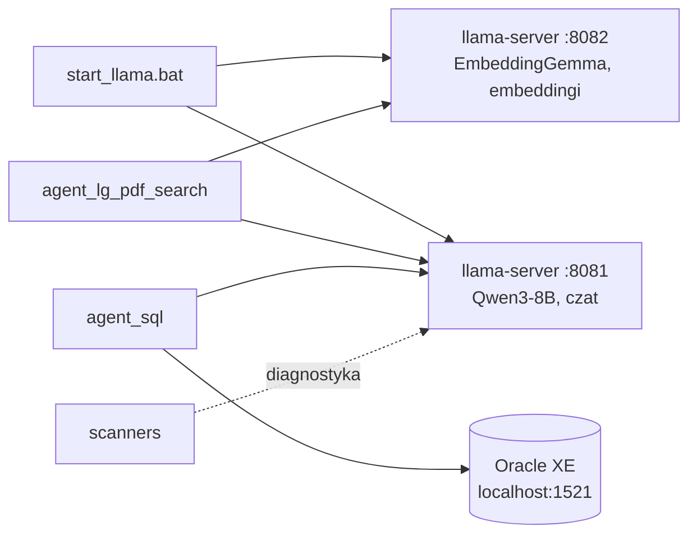
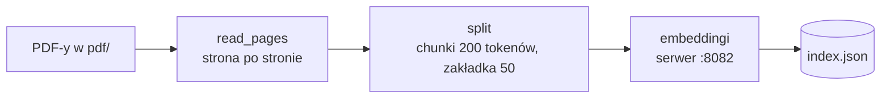
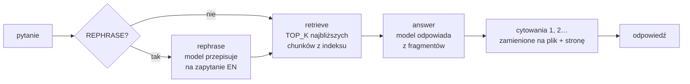
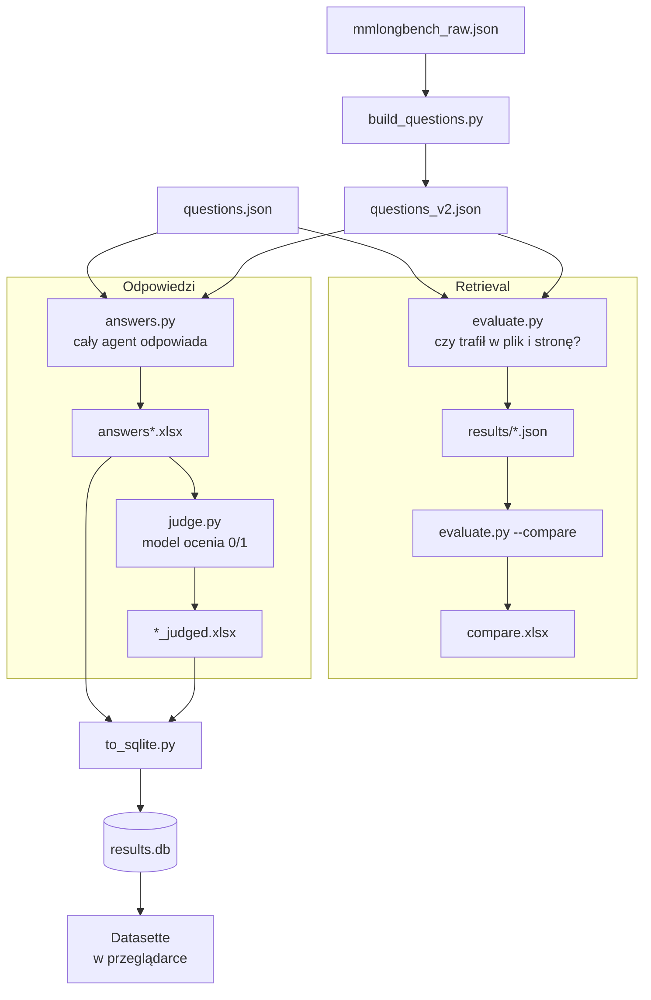
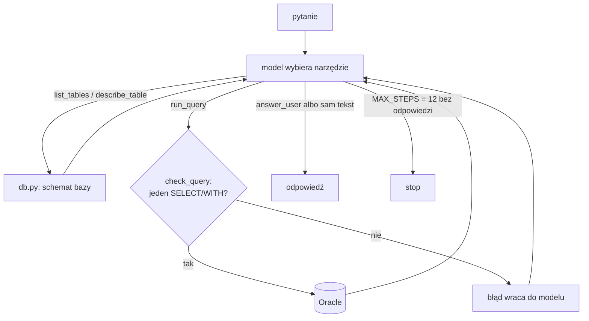

# Jak działa projekt — ściągawka

Wszystko działa lokalnie. Modele są uruchamiane przez llama-server, a agenci rozmawiają z nimi po HTTP.
Wszystkie polecenia uruchamiasz z katalogu głównego repo.

## Co jest w którym folderze

| Folder / plik | Co tam jest |
|---|---|
| `start_llama.bat` | startuje dwa serwery: czat (8081) i embeddingi (8082) |
| `models/` | `LIama/` to plik `llama-server.exe`, `llm/` to modele czatu, `embeddings/` to model embeddingów (poza gitem) |
| `agent_lg_pdf_search/` | agent LangGraph, który odpowiada na pytania o PDF-y |
| `agent_lg_pdf_search/config.py` | ustawienia: adresy serwerów, rozmiar chunka, `TOP_K`, `REPHRASE` |
| `agent_lg_pdf_search/index.py` | czyta PDF-y, tnie na chunki, liczy embeddingi i zapisuje `index.json`; też wyszukiwanie |
| `agent_lg_pdf_search/agent.py` | graf agenta i pętla w terminalu |
| `agent_lg_pdf_search/tools.py` | prompty, formatowanie fragmentów i cytowań; narzędzia `search_documents`, `get_page`, `find_text`, `list_documents` (jeszcze niepodpięte do grafu) |
| `agent_lg_pdf_search/eval/` | ewaluacja na pytaniach z MMLongBench-Doc |
| `eval/questions.json`, `questions_v2.json` | 30 i 143 pytania; v2 buduje `build_questions.py` z `mmlongbench_raw.json` |
| `eval/pdf/` | PDF-y do ewaluacji (osobne od `agent_lg_pdf_search/pdf/`) |
| `eval/results/` | wyniki: `*.json` i `compare.xlsx` z retrievalu, `answers*.xlsx` z odpowiedziami, `results.db` dla Datasette |
| `agent_sql/` | agent, który pyta bazę Oracle (tylko `SELECT`) |
| `scanners/` | skrypty do podglądania llama-servera: kontekst, KV cache, VRAM, tokeny, szablon czatu |
| `archive/` | pierwsze eksperymenty, nieużywane |
| `docs/` | notatki (ten plik) |

## Całość w jednym obrazku



## Agent PDF

### 1. Budowa indeksu (`python -m agent_lg_pdf_search.index`)



Indeks trzeba zbudować od nowa po dodaniu PDF-a albo zmianie ustawień chunków w `config.py`.

### 2. Odpowiedź na pytanie (`python -m agent_lg_pdf_search.agent`)



Rozmowa jest pamiętana między pytaniami dzięki checkpointerowi LangGraph.
`REPHRASE` jest domyślnie wyłączony.

## Ewaluacja

Są dwie osobne ścieżki. Pierwsza mierzy samo wyszukiwanie, druga całe odpowiedzi.



Kolumny w `answers*.xlsx`:
- `correct` to ocena ręczna,
- `judge` to ocena modelu,
- `page_hit` mówi, czy wyszukiwanie trafiło w dobrą stronę.

### Przeglądanie wyników

```powershell
python -m agent_lg_pdf_search.eval.to_sqlite
datasette agent_lg_pdf_search/eval/results/results.db --setting truncate_cells_html 200
```

Potem otwórz http://127.0.0.1:8001.
- Każdy plik xlsx to osobna tabela.
- Tabela `all_answers` zbiera wszystkie przebiegi naraz, a kolumna `run` mówi, z którego pliku pochodzi wiersz.
- Kliknięcie numeru wiersza pokazuje pełny tekst odpowiedzi.
- Po każdym nowym przebiegu uruchom `to_sqlite` ponownie.

Przykład zapytania SQL porównującego dwa przebiegi:

```sql
select a.question, a.judge as pipeline, b.judge as agent_0511
from answers_v2_pipeline_judged a
join "answers_v2_2026-11-05_judged" b using (question)
where a.judge != b.judge
```

Tabele, których nazwa ma myślnik, trzeba w SQL brać w cudzysłów, tak jak wyżej.

## Agent SQL (`python -m agent_sql.agent`)

Przed uruchomieniem ustaw zmienne środowiskowe `ORACLE_USER` i `ORACLE_PASSWORD`.



Każde pytanie, wywołanie narzędzia i SQL trafia do `agent_sql/agent.log`.

## Scanners (diagnostyka serwera)

| Skrypt | Co pokazuje |
|---|---|
| `llama_scanner.py` | czy model obsługuje narzędzia, ile kontekstu zmieści się w VRAM, szablon czatu z GGUF |
| `llama_server_info_endpoints.py` | raport ze wszystkich endpointów informacyjnych serwera |
| `server_info.py` | kontekst, koszt KV cache, model, pamięć GPU |
| `show_tokens.py` | tokenizacja tekstu |
